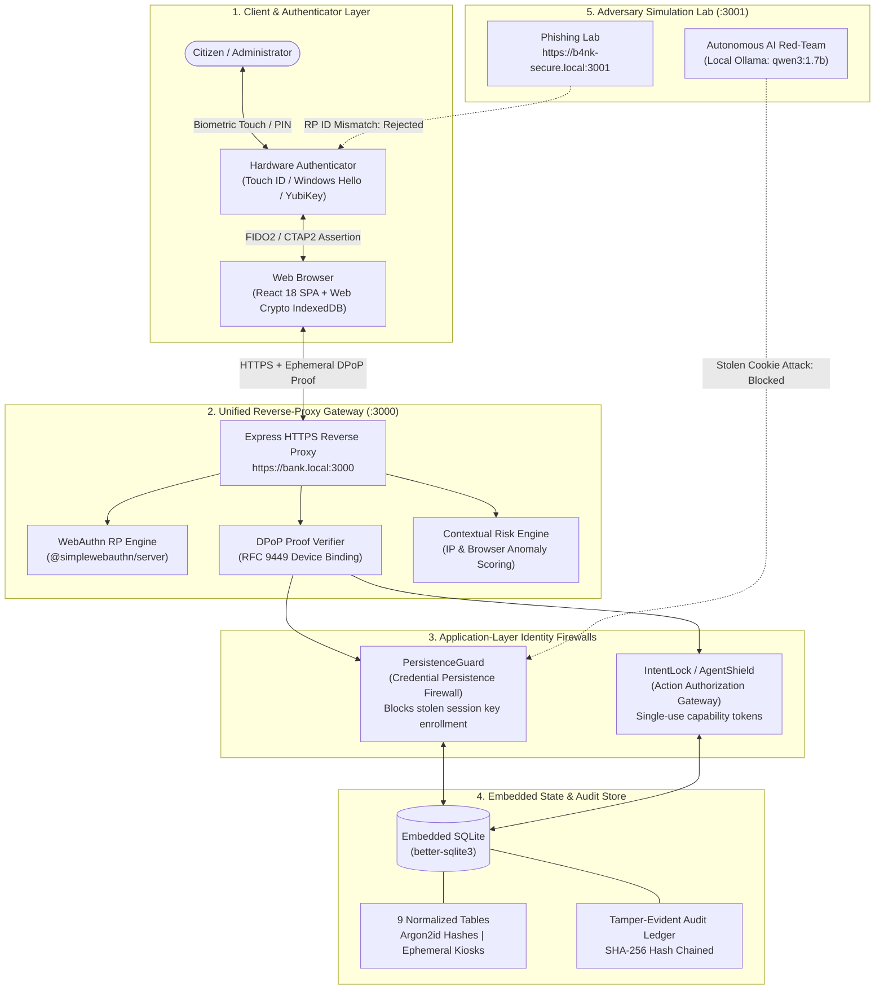

# TrustX SovereignPass

**Next-Generation Phishing-Resistant Passwordless Authentication, Application-Layer Identity Firewalls & Constrained AI-Agent Delegation**

* **Hackathon:** CyberCup 6.0 (24-Hour National Cybersecurity Hackathon)
* **Theme:** Theme 1: IoT & Cyber Security
* **Problem Statement:** CC6-IC04 — Next-Generation Passwordless Authentication
* **Lead Author & Contact:** Swayam Kohli ([swayamkohli11489@gmail.com](mailto:swayamkohli11489@gmail.com))
* **License:** Proprietary Source-Available Evaluation License (See [LICENSE](./LICENSE))

---

## Executive Overview

Authentication infrastructure across enterprise, fintech, and public services is under severe systemic pressure:
1. **Adversary-in-the-Middle (AiTM) Phishing:** Tools like Evilginx transparently proxy login pages, harvesting both passwords and live session cookies in real time.
2. **Social Engineering & OTP Scams:** The epidemic of SIM swapping, OTP interception, and "Digital Arrest" fraud in India exploits legacy SMS authentication.
3. **Session Hijacking & Infostealer Persistence:** Modern malware (RedLine, Lumma, Vidar) exfiltrates active browser cookies. Once an attacker obtains a session, standard systems permit them to register their own passkey, revoke the victim's device, and achieve permanent account lockout.
4. **Autonomous AI-Agent Hijacking:** As autonomous LLM agents are granted financial and operational autonomy, indirect prompt injection allows attackers to manipulate AI assistants into issuing unauthorized, high-value transactions.

**TrustX SovereignPass** resolves these vulnerabilities through an integrated, defense-in-depth architecture. Built upon **W3C WebAuthn / FIDO2** hardware cryptography, TrustX introduces **PersistenceGuard** (a Credential Persistence Firewall), **IntentLock** (an Identity-to-Action Firewall), **DPoP Device-Bound Sessions**, **Shared-Device Kiosk Security**, and **Zero-Downgrade Two-Phase Account Recovery**.

---

## Architectural Topology



---

## Nine Core Security Pillars

### 1. Origin-Bound Phishing Resistance (W3C WebAuthn / FIDO2)
* **Client-Side RP ID Isolation:** Passkey private keys are scoped cryptographically to the exact Relying Party ID (`bank.local`). When a user visits a look-alike phishing domain (`b4nk-secure.local`), the browser discovers zero matching credentials and refuses to prompt for biometrics.
* **Server-Side Origin Verification:** The backend strictly verifies that `clientDataJSON.origin` matches the expected origin (`https://bank.local:3000`). Forged or proxied assertions are instantly rejected with `HTTP 401`.

### 2. Credential Persistence Firewall (PersistenceGuard)
* **The Infostealer Problem:** Stolen session cookies allow attackers to bypass login screens entirely. In conventional systems, an attacker with a session cookie immediately registers their own passkey, revokes the victim's device, and steals the account permanently.
* **Our Solution:** Standard sessions have **zero authority** to alter account credentials. Any credential enrollment, revocation, or recovery-code replacement strictly requires fresh biometric elevation (`requireBiometricElevation`).
* **Autonomous AI Red-Teaming:** Integrates a local Ollama LLM (`qwen3:1.7b` or `llama3.2:1b`) that acts as an autonomous attacker holding a stolen session. The challenge harness proves that while an unshielded baseline allows full account takeover (HTTP 200), TrustX blocks all persistence attempts (HTTP 401/403).

### 3. Identity-to-Action Firewall (IntentLock / AgentShield)
* **Constrained AI Capability Gateway:** Prevents session hijacking and prompt injection from expanding financial authority.
* **Cryptographic Token Binding:** Every sensitive transaction requires a challenge-bound single-use capability token. The token cryptographically signs the exact recipient, amount ceiling, and single-use nonce. Any parameter modification (e.g. changing recipient or inflating transfer amount) is blocked with `HTTP 403 Forbidden`.

### 4. Device-Bound Sessions (DPoP — RFC 9449 Inspired)
* **Cryptographic Cookie Binding:** Upon authentication, the browser generates an asymmetric ECDSA P-256 keypair stored in IndexedDB (`CryptoKey`).
* **Replay Resistance:** Protected requests carry an ephemeral signed JWT proof (`X-DPoP`). A stolen session cookie replayed from an adversary machine lacking the client's private key is immediately rejected (`HTTP 401 DPOP_PROOF_REQUIRED`).

### 5. Shared-Device Kiosk Ephemeral Security
* **Public Terminal Safety:** Eliminates the danger of logging into public internet cafés, hospital terminals, or shared workstations.
* **Cross-Device QR Authentication:** The terminal displays a dynamic QR challenge paired with an in-memory client secret. The citizen scans the QR with their smartphone, confirms biometric passkey authentication, and authorizes a **15-minute ephemeral session** on the terminal.
* **Zero Residual Footprint:** Logging out or session expiry instantly purges all authorization records; zero passkeys or credentials ever touch the public device.

### 6. Zero-Downgrade Two-Phase Account Recovery
* **Elimination of SMS/Voice Fallback:** Completely deprecates insecure SMS OTP recovery channels.
* **Argon2id Salted Hashes:** Citizens receive 8 high-entropy single-use recovery codes upon onboarding, stored on the server strictly as Argon2id hashes.
* **Lockout Prevention:** Phase 1 validates the recovery code and issues a replacement passkey registration challenge, but **does not consume the recovery code yet**. Phase 2 verifies the new passkey attestation and atomically burns the recovery code in an ACID transaction. If the user cancels or loses connectivity, existing access remains safe.

### 7. Dynamic Contextual Risk Engine & Step-Up
* **Contextual Anomaly Detection:** Real-time scoring of client IP novelty and browser user-agent anomalies.
* **Selective Friction:** Low-risk familiar devices experience seamless passwordless login. High-risk anomalous contexts trigger an explicit biometric step-up requirement before session completion or high-value operations.

### 8. Live Admin SOC & Tamper-Evident Audit Ledger
* **Real-Time Incident Stream:** Admin Security Operations Center (SOC) dashboard displaying paginated, filterable security events (`USER_LOGIN_SUCCESS`, `PHISHING_ORIGIN_REJECTED`, `AGENT_ACTION_BLOCKED`).
* **One-Click Session Termination:** Administrators can instantly invalidate compromised sessions across the entire fleet.
* **SHA-256 Hash Chaining:** Audit log entries are chained cryptographically to detect unauthorized modifications or record deletion.

### 9. Demographic Inclusivity & Accessibility
* **Bilingual Support:** Full English and Hindi UI localization (`i18n.ts`).
* **Spoken Local Guidance:** Built-in speech synthesis (`AudioHelp.tsx`) providing spoken assistance for non-literate or visually impaired users.
* **Four Persona Profiles:** Pre-configured demographic testing personas:
  * *Ramesh Kumar:* Rural farmer operating on shared kiosk terminals.
  * *Priya Sharma:* High-volume UPI merchant with strict step-up controls.
  * *Vikram Malhotra:* Corporate enterprise admin managing SOC fleet credentials.
  * *Sunita Devi:* Elderly pensioner assisted by high-contrast accessibility flows.

---

## Live Demonstration Cockpit & Access Points

The development stack runs both the legitimate bank and the adversary lab concurrently.

| Interface | URL (Local HTTP Mode) | URL (Trusted HTTPS Mode) | Access Role | Description |
| :--- | :--- | :--- | :--- | :--- |
| **Bank Web App** | `http://localhost:3000` | `https://bank.local:3000` | Citizen | Full banking portal, passkey registration, balance ledger, and step-up transfer. |
| **Demo Arena** | `http://localhost:3000/demo` | `https://bank.local:3000/demo` | Evaluator | Multi-window cockpit for launching side-by-side attack/defense simulations. |
| **Phishing Lab** | `http://127.0.0.1:3001/phishing` | `https://b4nk-secure.local:3001/phishing` | Adversary | Controlled attacker domain proving RP ID isolation & credential harvesting capture. |
| **PersistenceGuard** | `http://localhost:3000/persistence` | `https://bank.local:3000/persistence` | Admin | Credential Persistence Firewall lab with real local Ollama red-team comparison. |
| **AgentShield** | `http://localhost:3000/agent` | `https://bank.local:3000/agent` | Citizen / Admin | IntentLock AI capability gateway comparing vulnerable sandbox vs TrustX gateway. |
| **Admin SOC** | `http://localhost:3000/admin` | `https://bank.local:3000/admin` | Admin | Real-time incident event feed, active sessions monitor, and passkey inventory. |
| **Crypto Lab** | `http://localhost:3000/crypto` | `https://bank.local:3000/crypto` | Evaluator | In-browser NIST FIPS 204 (ML-DSA-44) vs ECDSA P-256 cryptographic benchmark studio. |
| **Access Help** | `http://localhost:3000/access-help` | `https://bank.local:3000/access-help` | Citizen | Bilingual guide, voice guidance, and demographic persona selector. |

---

## Quickstart & Installation

### Prerequisites
* **Node.js:** v20.x or v22.x+
* **npm:** v10.x+
* *(Optional)* **mkcert:** For trusted local HTTPS (`bank.local` and `b4nk-secure.local`)
* *(Optional)* **Ollama:** For live local AI red-teaming (`ollama run qwen3:1.7b`)

### 1. Installation
Clone the repository and install all workspace dependencies from root:

```bash
git clone https://github.com/SwayamKohli/TrustX.git
cd TrustX
npm install
```

### 2. Launch the Development Stack
Start the unified stack (Bank Backend `:3000`, Internal Vite Frontend `:5173`, and Attacker Lab `:3001`):

```bash
npm run dev
```

* For zero-config local evaluation, open **`http://localhost:3000/demo`**.
* The attacker lab runs at **`http://127.0.0.1:3001/phishing`** in a separate browser window.

### 3. Grant Administrator Privileges
Register a new username via the UI, then promote the account to Administrator:

```bash
npm run admin:grant -- <username>
```

---

## Verification & Automated Testing

### 1. Automated Security Attack Probes (10 Vectors)
Execute the canonical attack suite against production Express routers and an isolated in-memory test database:

```bash
npm run test:attacks
```

### 2. Monorepo Unit & Integration Tests
Run all unit and integration test suites across frontend and backend packages:

```bash
npm test
```

### 3. Production Build Verification
Compile TypeScript and bundle the frontend production distribution:

```bash
npm run build
```

### 4. Post-Quantum Cryptography Benchmark
Execute 100 trials comparing classical ECDSA P-256 against NIST FIPS 204 ML-DSA-44:

```bash
npm run benchmark:pqc
```

---

## Project Directory Organization

```text
TrustX/
├── .env.example                               # Default environment variable template
├── .env.phone.example                         # Mobile device / LAN IP environment template
├── .gitignore                                 # Git ignore directives
├── LICENSE                                    # Proprietary Source-Available Evaluation License
├── README.md                                  # This master documentation file
├── package.json                               # Root package manifest & workspace scripts
├── package-lock.json                          # Pinned dependency lockfile
├── tsconfig.json                              # TypeScript root configuration
├── certs/                                     # Local TLS certificates (mkcert)
│   ├── README.md                              # Certificate generation & local DNS setup
│   ├── cert.pem                               # Local development SSL certificate
│   └── key.pem                                # Local development SSL private key
├── docs/                                      # Master documentation hub
│   ├── README.md                              # Documentation index & navigation
│   ├── architecture.md                        # Relational schema, WebAuthn flow, and reverse proxy
│   ├── final-evaluation.md                    # Official final-evaluation runbook & live verification
│   ├── compliance-and-frameworks.md           # CERT-In, RBI, DPDP Act 2023, and NIST AAL3 mapping
│   ├── execution-roadmap.md                   # 24-hour sprint progression & milestones
│   ├── iphone-rehearsal.md                    # Physical iPhone/Android HTTPS testing guide
│   ├── security/                              # Formal threat modeling
│   │   ├── README.md                          # Security folder overview
│   │   └── THREAT_MODEL.md                    # STRIDE threat model & residual risk disclosures
│   └── archive/                               # Historical hackathon records & battle plans
│       ├── README.md                          # Archive manifest & document index
│       ├── TEAM_TASK_BREAKDOWN.md             # Original team ownership matrix & interface contracts
│       ├── master-task-checklist.md           # P0/P1/P2 task checklist
│       ├── target-users-and-final-battle-plan.md
│       ├── pitch-deck-and-judge-defense-strategy.md
│       ├── evaluation2-pitch-deck-and-demo-script.md
│       ├── evaluation2-battle-plan-and-execution.md
│       ├── statutory-compliance-and-security-frameworks.md
│       ├── day2-and-hackathon-execution-steps.md
│       └── cybercup-ic04-supercharged-blueprint.md
├── packages/                                  # Monorepo workspaces
│   ├── README.md                              # Workspace architecture & data-flow diagram
│   ├── backend/                               # Express HTTPS API, WebAuthn RP, SQLite & AI services
│   │   ├── README.md                          # Detailed backend API routes, schema, and scripts
│   │   ├── package.json
│   │   ├── src/                               # TypeScript backend source
│   │   └── test/                              # Backend integration test suites
│   └── frontend/                              # React 18 SPA (Vite, Tailwind CSS, Lucide React)
│       ├── README.md                          # Detailed frontend views, components, and design system
│       ├── package.json
│       ├── src/                               # TypeScript client source
│       └── vite.config.ts
├── scripts/                                   # Automation scripts & benchmarks
│   ├── README.md                              # Automation tooling overview
│   ├── start-dev.cjs                          # Stack launcher with port occupancy detection
│   ├── start-dev.test.cjs                     # Launcher unit test suite
│   └── benchmarks/                            # Cryptographic benchmark suites
│       ├── README.md                          # PQC benchmark rationale & measured trade-offs
│       └── pqc_benchmark.ts                   # NIST FIPS 204 (ML-DSA-44) vs ECDSA P-256 script
└── tests/                                     # Automated security probes
    ├── README.md                              # Security test runner & 10 attack vectors matrix
    ├── test_attacks.ts                        # Canonical attack suite CLI runner
    └── mock_phishing_server.ts                # Mock adversary server definition
```

---

## Team & Authorship Credits

TrustX SovereignPass was designed, engineered, and demonstrated by **Team TrustX** during the 24-hour **CyberCup 6.0 Hackathon**:

| Team Member | Role & Focus | Primary Contributions | GitHub Profile |
| :--- | :--- | :--- | :--- |
| **Swayam Kohli** | **Team Lead, Architecture, Systems & AI Lead** | Monorepo architecture & reverse proxy (`server.ts`), DPoP device-bound session enforcement (`dpop.middleware.ts`), IntentLock capability gateway (`agent.service.ts`), contextual risk engine (`risk.middleware.ts`), NIST FIPS 204 PQC benchmark (`pqc_benchmark.ts`), demographic banking personas, and bilingual audio accessibility. | [@SwayamKohli](https://github.com/SwayamKohli) |
| **Sanchit Mishra** | **Core Backend & Identity Lifecycle Lead** | Relational SQLite database schema (9 tables, Argon2id hashing, transactions), core WebAuthn Relying Party ceremonies (`webauthn.service.ts`), two-phase lockout-safe recovery engine (`recovery.routes.ts`), passkey device lifecycle & revocation (`devices.routes.ts`), shared kiosk ephemeral engine (`kiosk.routes.ts`), and session middleware. | [@san-10-max](https://github.com/san-10-max) |
| **Ananya Robinson** | **Product, UI/UX & Admin SOC Lead** | Complete React 18 client application (`@trustx/frontend`), accessible UI/UX component library, Admin SOC real-time event dashboard (`AdminSOCPage.tsx`), multi-window Demo Arena (`DemoArenaPage.tsx`), PersistenceGuard visual flow (`PersistenceGuardPage.tsx`), Lucide icon migration, and WCAG 2.1 AA accessibility design. | [@ananya411-robinson](https://github.com/ananya411-robinson) |
| **Syed Adnan Ahmed Hanfi** | **Security Lead & Attack/Defense Engineer** | Canonical automated attack verification suite (`test_attacks.ts` - 10 security probes), comprehensive STRIDE Threat Model (`THREAT_MODEL.md`), adversary phishing server infrastructure (`phishing-server.ts`), local multi-domain SSL certificate provisioning (`certs/`), and CERT-In compliance audit mapping. | [@Theshyguy01](https://github.com/Theshyguy01) |

---

## License & Usage Permissions

TrustX SovereignPass is released under a **Proprietary Source-Available Evaluation License**.

* The source code is publicly viewable for academic review, security evaluation, and educational demonstration purposes.
* Any commercial deployment, reproduction, distribution, sublicensing, modification, or production usage is strictly prohibited without prior written authorization.

For licensing permissions, partnership inquiries, or commercial integration:
* **Contact:** Swayam Kohli
* **Email:** [swayamkohli11489@gmail.com](mailto:swayamkohli11489@gmail.com)
