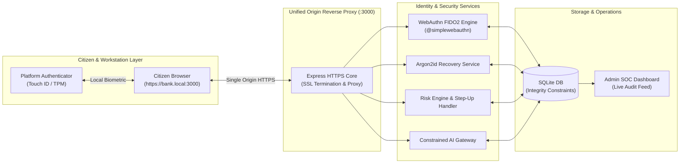

# TrustX SovereignPass — Master Visual Slide Deck Blueprint
**CYBERCUP 6.0 | Theme 1: IoT & Cyber Security | Problem Statement: CC6-IC04**  
**Design Theme:** Dark Cybersecurity / SOC Aesthetic (Midnight Navy `#070D18`, Electric Cyan `#00F0FF`, White `#F8FAFC`, Coral Red `#EF4444`, Amber Warning `#F59E0B`)

---

## 1. Visual Design Language & Color Palette

```
  ┌─────────────────┬─────────────────┬─────────────────┬─────────────────┐
  │ Midnight Navy   │ Electric Cyan   │ Clean White     │ Threat Red      │
  │ #070D18 (Bg)    │ #00F0FF (Flow)  │ #F8FAFC (Text)  │ #EF4444 (Block) │
  └─────────────────┴─────────────────┴─────────────────┴─────────────────┘
```
- **Rule 1 (Diagram-First):** Every slide has a visual focal point (architecture diagram, lifecycle loop, icon grid, or terminal evidence panel) taking up 60% of the screen.
- **Rule 2 (Zero Paragraphs):** No bullet point exceeds 12 words. High contrast, high readability.
- **Rule 3 (Observable Evidence):** Real screenshots of the running UI and actual terminal output from `npm test` and `npm run benchmark:pqc`.

---

## 2. Visual Slide-by-Slide Architecture & Layout

### Slide 1: The Identity Security Hero (Title Slide)
- **Visual Aesthetic:** Minimalist dark navy canvas with subtle glowing cyan grid. Center features a prominent cryptographic shield icon.
- **Layout (50/50 Split or Centered Hero):**
  - **Center Hero:**
    ```
    ╔═══════════════════════════════════════════════════════════════════════╗
    ║                           CYBERCUP 6.0                                ║
    ║                                                                       ║
    ║                     TRUSTX SOVEREIGNPASS                              ║
    ║        Next-Generation Passwordless Identity Security Platform        ║
    ╚═══════════════════════════════════════════════════════════════════════╝
    ```
  - **Bottom Metadata Bar (Clean 4-column footer):**
    - **Theme:** Theme 1 — IoT & Cyber Security
    - **Problem Statement ID:** CC6-IC04
    - **Problem Statement Title:** Next-Generation Passwordless Authentication
    - **Team:** Swayam Kohli (Lead) · Adnan · Ananya · Sanchit
- **Speaker:** Swayam (15s).

---

### Slide 2: Threat Landscape vs. TrustX Defenses (30s)
- **Visual Design:** Left-to-right attack vs. defense comparison diagram.
```
  ATTACK VECTORS (Threat Red)              TRUSTX DEFENSES (Electric Cyan)
  ┌───────────────────────────────┐        ┌───────────────────────────────┐
  │ ✗ Phishing Look-Alike Domains │  ───►  │ ✓ Origin-Bound WebAuthn (FIDO2)│
  ├───────────────────────────────┤        ├───────────────────────────────┤
  │ ✗ SMS OTP SIM-Swapping Traps  │  ───►  │ ✓ Argon2id 2-Phase Recovery   │
  ├───────────────────────────────┤        ├───────────────────────────────┤
  │ ✗ Public Kiosk Session Theft  │  ───►  │ ✓ 15-Min Zero-Residue Kiosk QR│
  ├───────────────────────────────┤        ├───────────────────────────────┤
  │ ✗ Credential Invalidation Gaps│  ───►  │ ✓ Immediate Multi-Device Purge│
  └───────────────────────────────┘        └───────────────────────────────┘
```
- **Key Takeaway:** Passkeys eliminate passwords, but security fails if recovery defaults to SMS. TrustX secures the *entire identity lifecycle*.
- **Speaker:** Swayam (30s).

---

### Slide 3: Delivering All Seven Requirements (35s)
- **Visual Design:** A balanced **4 + 3 icon grid** with bold headers and single-sentence descriptions.

```
┌───────────────────────────┬───────────────────────────┬───────────────────────────┬───────────────────────────┐
│ [1] PASSWORDLESS AUTH     │ [2] PHISHING RESISTANCE   │ [3] SECURE RECOVERY       │ [4] MULTI-DEVICE MGMT     │
│ WebAuthn passkeys via     │ Origin-bound RP ID        │ 8 single-use codes,       │ Enrol secondary passkeys; │
│ platform authenticators   │ isolation at browser and  │ Argon2id-hashed with      │ instant server-side       │
│ (Touch ID/Windows Hello). │ backend verification.     │ atomic 2-phase replacement│ credential revocation.    │
└───────────────────────────┴───────────────────────────┴───────────────────────────┴───────────────────────────┘
┌───────────────────────────────────────┬───────────────────────────────────────┬───────────────────────────────┐
│ [5] INCLUSIVE & KIOSK ACCESS          │ [6] CONTEXTUAL RISK ENGINE            │ [7] ADMIN SOC DASHBOARD       │
│ Ephemeral 15-min QR kiosk sessions;   │ Anomaly scoring (IP/device shifts)    │ Real-time credential monitor, │
│ hardware security key alternatives.   │ with request-bound step-up re-auth.   │ 1-click session kill & audit. │
└───────────────────────────────────────┴───────────────────────────────────────┴───────────────────────────────┘
```
- **Speaker:** Sanchit or Swayam (35s).

---

### Slide 4: System Architecture & Data Flow (40s)
- **Visual Design:** Full-width clean architectural block diagram showing client, reverse proxy, services, and storage.



- **Key Callouts:**
  - **Private keys remain local:** The server stores only public credentials; biometric processing is local to the authenticator.
  - **Unified Origin (`:3000`):** Single HTTPS reverse proxy simplifies same-origin enforcement, avoids cross-origin port complexity, and ensures strict RP ID matching.
- **Speaker:** Sanchit (40s).

---

### Slide 5: Real Product Evidence & Live Attack Demonstration (55s)
- **Visual Design (Split Screen):**
  - **Left (50%):** Screenshots of the running TrustX application:
    - *Onboarding screen:* Clean passkey creation form.
    - *Modal screenshot:* The **8 Emergency Recovery Codes** `<dialog>` modal with copy/download buttons and confirmation checkbox.
  - **Right (50%):** Live Terminal & Attack Test Output (Real Verified Outputs):
    ```
    $ npm test
    ✓ Risk Engine: Contextual anomaly scoring & intent hashing verified.
    ✓ AI Agent Delegation: Prompt-injection defense & replay prevention verified.
    ✓ Real passkey contracts: 8 Vitest frontend tests passed (406ms).
    
    $ npm run benchmark:pqc
    ✓ Classical ECDSA P-256 Sign: 0.030 ms (32,858 ops/sec) | Sig: 70 B DER
    ✓ NIST FIPS 204 ML-DSA Sign:  9.948 ms (101 ops/sec)    | Sig: 2,420 B
    ```
- **Demo Script (Adnan):**
  1. Show genuine login on `https://bank.local:3000`.
  2. Switch to look-alike simulator `https://b4nk-secure.local:3001` — show the browser discovering 0 credentials for the fake RP ID.
  3. Separately run backend negative assertion test showing mismatched origin rejection.
  4. Run `npm test` live in the terminal to prove automated rejection of challenge replays, single-use code reuse, and prompt-injection constraint violations.
  - *(Demo Resilience: Keep recorded backup clips/screenshots ready in backup slides in case offline Bluetooth/Wi-Fi has latency).*
- **Speaker:** Adnan (55s).

---

### Slide 6: The Complete Identity Lifecycle & Forward-Looking Research (35s)
- **Visual Design:** Circular lifecycle loop on the left; compact PQC benchmark card on the right.

```
       IDENTITY LIFECYCLE LOOP                        POST-QUANTUM RESEARCH CARD
                                                ┌───────────────────────────────────────┐
             [ REGISTER ]                       │ NIST FIPS 204 ML-DSA-44 vs. ES256     │
                  │                             ├───────────────────────────────────────┤
                  ▼                             │ • Classical Sig:     70 bytes (0.03ms)│
            [ AUTHENTICATE ]                    │ • ML-DSA Sig:     2,420 bytes (9.9ms) │
                  │                             │ • Measured Ratio: ~34x larger payload │
                  ▼                             ├───────────────────────────────────────┤
          [ CONTEXTUAL RISK ]                   │ Architectural Finding:                │
                  │                             │ Evaluates potential BLE/NFC packet    │
                  ▼                             │ overhead; justifies hybrid crypto-    │
        [ RECOVER & REVOKE ]                    │ agility roadmap.                      │
                  │                             └───────────────────────────────────────┘
                  ▼
          [ SOC MONITORING ]
```
- **Key Callout:** We connect authentication, recovery, device revocation, and session invalidation into a single atomic lifecycle.
- **Speaker:** Swayam (35s).

---

### Slide 7: Honest Security Boundaries & Conclusion (25s)
- **Visual Design:** Two clean side-by-side summary cards.

```
┌───────────────────────────────────────────────┬───────────────────────────────────────────────┐
│ WHAT TRUSTX DEFENDS                           │ RESIDUAL BOUNDARIES & HONEST LIMITS           │
├───────────────────────────────────────────────┼───────────────────────────────────────────────┤
│ ✓ Look-alike credential harvesting & phishing │ • Does not prevent endpoint malware/keyloggers│
│ ✓ Credential stuffing & password reuse        │ • Recovery codes remain sensitive secrets     │
│ ✓ Weak SMS OTP downgrade & SIM-swap bypass    │ • Kiosk QR serves smartphone owners; non-phone│
│ ✓ Public workstation session lingering        │   users rely on physical hardware keys        │
│ ✓ Parameter manipulation in AI transactions   │ • Structured UTC audit logging (CERT-In ref)  │
└───────────────────────────────────────────────┴───────────────────────────────────────────────┘
```
- **Closing Statement (Swayam):**
  > *"TrustX SovereignPass proves that passwordless security is only as strong as its recovery and revocation lifecycle. We built a system that doesn't compromise on weak fallbacks, and we proved it through live attack tests. Thank you."*

---

## 3. Quick Reference Judge Defense Shield

| Question | Bulletproof 15-Second Defense |
| :--- | :--- |
| **Q1: What makes TrustX different from basic passkeys?** | *"Basic passkeys solve login, but fail when a device is lost because they fall back to SMS OTP. TrustX solves the complete identity lifecycle: Argon2id two-phase recovery, zero-residue shared kiosk access, and live attack probes."* |
| **Q2: How do you handle lost phones without SMS OTP?** | *"We issue 8 high-entropy single-use codes stored as Argon2id hashes. In Phase 1, the code is verified. In Phase 2, a replacement passkey is enrolled, the code is burned, and old credentials/sessions are revoked in a single atomic transaction."* |
| **Q3: Can an Evilginx reverse proxy intercept the passkey?** | *"No. WebAuthn signs the browser-verified origin (`clientDataJSON`). A look-alike proxy origin will fail browser RP ID scoping, and any relayed mismatched assertion is rejected by our backend."* |
| **Q4: How do you support users without smartphones?** | *"Kiosk QR solves shared PCs for smartphone owners. For citizens without smartphones, the industry standard is physical FIDO2 USB/NFC security keys or assisted in-person recovery. We do not use SMS fallback because SMS is vulnerable to SIM swapping."* |
| **Q5: Are you compliant with Indian regulations?** | *"We do not claim formal government certification for a prototype. However, TrustX is designed with direct reference to statutory principles: DPDP Act 2023 for biometric data minimization, CERT-In Rule 2(v) for structured UTC ISO-8601 logging, and RBI guidelines for phishing-resistant MFA."* |
| **Q6: Why include PQC if WebAuthn doesn't use it yet?** | *"WebAuthn authenticators currently standardize on classical ECDSA P-256. We ran a live benchmark of NIST FIPS 204 ML-DSA-44 proving signatures are ~34x larger (2,420 bytes vs 70 bytes), creating BLE/NFC bottlenecks and demonstrating why hybrid crypto-agility is necessary."* |
| **Q7: How does the AI gateway prevent prompt injection?** | *"The gateway does not prevent LLM prompts from being altered; it prevents prompt injection from executing unauthorized transactions. Biometric passkey sign-off mints an HMAC capability token bound to the approved recipient and amount ceiling, blocking manipulated parameters server-side."* |
