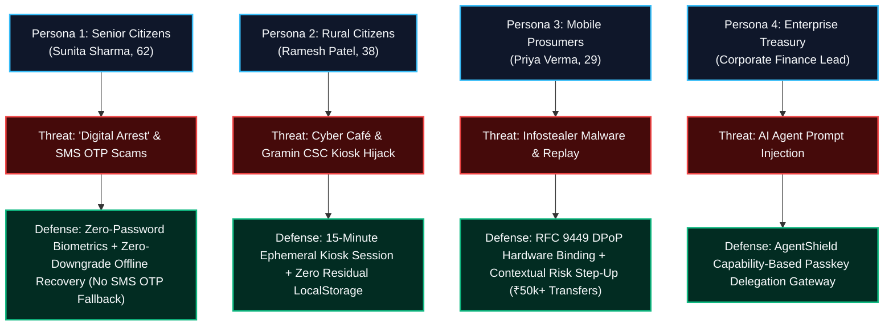

# TrustX SovereignPass — Final 6-Hour Sprint & Target User Defense Strategy
**CyberCup 6.0 | Problem CC6-IC04: Next-Generation Passwordless Authentication**  
**Milestone:** Final Evaluation (6 Hours Remaining) | **Status:** High Priority

---

## 1. Deconstructing the Judge Feedback: "Who Are Your Targeted Users?"

During Evaluation 2, the judges observed:
> *"Who are your targeted users? You aren't focusing on something!"*

### Why the Judges Asked This:
1. **Abstract Security vs. Real-World Impact:** When presented strictly as technical protocol tests (FIDO2, DPoP, origin mismatch, capability tokens), judges can perceive the project as an "abstract cryptographic sandbox" rather than a deployable product solving India's urgent cyber threats.
2. **Authentication is Not One-Size-Fits-All:** India's digital landscape has 900+ million internet users with vastly different literacy, device capabilities, and threat profiles. An enterprise executive does not have the same threat model as a 65-year-old pensioner or a rural farmer at a Common Service Centre (CSC).

### Our Winning Strategic Pivot:
Instead of narrowing down to *only* one niche, we prove that **TrustX SovereignPass is architected specifically for the diverse spectrum of the Indian Digital Public Infrastructure (DPI)**. We explicitly present **4 Targeted Citizen Personas**, mapping each feature directly to their daily lives and statutory protections.

---

## 2. The 4 Targeted Citizen Personas (Indian Demographics)

### Persona 1: Sunita Sharma (62, Retired School Teacher, Bhopal)
* **Demographic Context:** Tier-2 city, uses a basic smartphone, limited tech literacy, primarily speaks Hindi.
* **The Real-World Indian Threat:** **"Digital Arrest" & Fake KYC Scams.** Scammers impersonating CBI or Telecom Department call her, threatening arrest unless she reads out an SMS OTP or clicks a fake bank link sent via WhatsApp. In 2024, Indian citizens lost over ₹1,750 crore to Digital Arrest scams.
* **How TrustX Protects Sunita:**
  1. **Zero Passwords / Zero OTPs:** Sunita logs in using only her fingerprint (Touch ID / FaceID). There is **no OTP sent over SMS**, so she cannot be coerced into reading it to a scammer on the phone.
  2. **Zero-Downgrade Recovery:** If she loses her phone, recovery is via offline Argon2id printed backup cards. No scammer can perform a SIM-swap attack.
  3. **Linguistic Inclusion:** The entire UI toggles to **हिन्दी (Hindi)** with clear, non-technical instructions.

---

### Persona 2: Ramesh Patel (38, Farmer / Small Business, Dahod, Gujarat)
* **Demographic Context:** Rural citizen, Jan Dhan bank account, does not own a personal laptop. Accesses government banking services (PM-KISAN, DBT, crop insurance) through a **Common Service Centre (CSC) or Gramin banking kiosk**.
* **The Real-World Indian Threat:** **Shared Workstation Session Abandonment.** Cyber café / CSC computers are infected with keyloggers, and users frequently forget to log out, leaving static session cookies exposed to the next customer.
* **How TrustX Protects Ramesh:**
  1. **15-Minute Ephemeral Kiosk Session:** Ramesh approaches the kiosk, scans the dynamic QR with his phone, and enters the 6-character match code.
  2. **Zero Residual Storage:** The kiosk is granted a temporary session that self-destructs after 15 minutes. No refresh tokens, private keys, or passwords ever touch the kiosk's disk.
  3. **Privilege Isolation:** Ramesh can view his balance and execute transfers, but the kiosk cannot add new devices or revoke credentials.

---

### Persona 3: Priya Verma (29, Fintech Product Manager, Bengaluru)
* **Demographic Context:** High-frequency digital banking, multiple devices (iPhone, MacBook, YubiKey). Transacts daily via UPI and net banking.
* **The Real-World Indian Threat:** **Infostealer Malware (Lumma/RedLine) & High-Value Account Takeover.** Malicious browser extensions steal session cookies from memory and replay them from offshore IP addresses.
* **How TrustX Protects Priya:**
  1. **Device-Bound Sessions (RFC 9449 DPoP):** Even if malware dumps Priya's session cookie, replaying it from an attacker laptop fails (`HTTP 401 DPOP_PROOF_REQUIRED`) because the attacker lacks her browser's hardware private key.
  2. **Contextual Risk Engine & Biometric Step-Up:** Everyday transactions (₹450 bill) flow without friction (Risk Score: 10/100). But if a high-value transfer (₹50,000) or unusual IP is detected, the system automatically triggers a **Biometric Step-Up Re-Authentication** via Touch ID.
  3. **Multi-Device Lifecycle:** 1-click instant revocation of stolen laptops.

---

### Persona 4: Enterprise Treasury & Corporate Accounts (AI-Driven Operations)
* **Demographic Context:** Corporate treasurer delegating routine financial tasks (vendor payouts, recurring electricity bills) to autonomous AI agents (e.g. LangChain, AutoGPT).
* **The Real-World Indian Threat:** **LLM Prompt Injection.** A malicious invoice contains hidden prompt instructions tricking the AI agent into transferring funds to an offshore attacker wallet.
* **How TrustX Protects Enterprise:**
  1. **AgentShield Capability Gateway:** The user signs a single-use capability token specifying an exact recipient (`Electricity Board`) and strict ceiling (`₹500`).
  2. **Kernel-Level Enforcement:** When the injected AI tries to transfer ₹1,000 to `Attacker Sandbox`, TrustX blocks it with `HTTP 403 Forbidden`.

---

## 3. High-Impact Enhancements for the Final 6 Hours

To ensure **nothing looks precoded, hardcoded, or ambiguous**, we are implementing three major, visible features:

### Action Item 1: Native English / हिन्दी (Hindi) Localization Toggle
* Add a `[ English | हिन्दी ]` toggle switch in the app header.
* When toggled to हिन्दी, all key citizen workflows (Sign In, Create Account, Kiosk, Risk Engine, Recovery) render in native, grammatically sound Hindi.
* **Why it wins:** When the judges ask "Who is your target user?", you switch to Hindi and demonstrate how TrustX caters to the next 500 million Indian citizens who are currently excluded or vulnerable to English-only phishing attacks.

### Action Item 2: Interactive "Target Citizen Journeys" Selector
* Add a prominent Persona Guide banner at the top of the app:
  * Click **Sunita Sharma (Senior Citizen)** $\rightarrow$ Highlights Anti-Digital Arrest & Zero-OTP Protection.
  * Click **Ramesh Patel (Rural Kiosk)** $\rightarrow$ Opens Ephemeral Kiosk Auth with 15-min countdown.
  * Click **Priya Verma (Digital Prosumer)** $\rightarrow$ Opens Dashboard with DPoP Device Binding & Step-Up.
  * Click **Enterprise Treasury** $\rightarrow$ Opens AgentShield Capability Gateway.

### Action Item 3: Live "Simulated Sovereign Banking Operations" in Dashboard
* Add an interactive banking card in `DashboardPage.tsx`:
  * Account Balance: ₹1,25,000
  * **Action 1: Pay Electricity Bill (₹450)** $\rightarrow$ Low Risk (Score 10). Executes smoothly, drops balance to ₹1,24,550.
  * **Action 2: High-Value Transfer (₹50,000 to New Beneficiary)** $\rightarrow$ Anomaly threshold triggered ($\ge 70$). Automatically pops up the **Touch ID / Biometric Passkey Step-Up Ceremony**! Once verified, completes the transfer and logs the step-up token consumption.
* **Why it wins:** Transforms TrustX from an abstract auth library into a living, breathing next-generation banking application.

---

## 4. Final Evaluation Presentation Script (Addressing the Critique Head-On)

### Slide / Opening Pitch (First 30 Seconds):
> *"In Evaluation 2, the judges asked a pivotal question: **Who is your targeted user?**"*  
> *"Our answer is that digital authentication in India cannot be one-size-fits-all. India's threat landscape spans from senior citizens losing their life savings to Digital Arrest scams in Bhopal, to rural citizens sharing computers at Common Service Centres in Gujarat, to high-net-worth individuals delegating funds to autonomous AI agents."*  
> *"TrustX SovereignPass is the first unified passwordless platform architected with tailored cryptographic protections for all 4 segments of the Indian demographic."*

### Live Persona Walkthrough (2 Minutes):
1. **Show Persona 1 (Senior Citizen - Sunita Sharma):**
   - Flip language toggle to **हिन्दी**.
   - Show 1-touch fingerprint login. Point out: *"No SMS OTP is ever generated. A scammer calling Sunita cannot coerce her into sharing an OTP, because no OTP exists in our architecture."*
2. **Show Persona 2 (Rural Kiosk - Ramesh Patel):**
   - Click **"Use a shared terminal"** (`/kiosk-auth`).
   - Show dynamic match code & 15-minute countdown. Point out: *"Ramesh gets a self-destructing session that leaves zero cryptographic residue or cookies on the cyber café computer."*
3. **Show Persona 3 (Prosumer - Priya Verma):**
   - In My Account, show Risk Score (10/100).
   - Click **"Transfer ₹50,000"** $\rightarrow$ Show the browser prompting **Touch ID Step-Up re-authentication** live!
   - Show the stolen cookie replay test in Demo Arena $\rightarrow$ `HTTP 401 DPOP_PROOF_REQUIRED`.
4. **Show Persona 4 (Enterprise AI):**
   - In AgentShield, show prompt-injection attack blocked with `HTTP 403`.

### Closing (30 Seconds):
> *"TrustX SovereignPass is not just a passwordless demo—it is a comprehensive, inclusive, and future-proof sovereign identity infrastructure aligned with RBI Master Directions 2024, CERT-In guidelines, and the Digital Personal Data Protection Act 2023. Thank you."*
