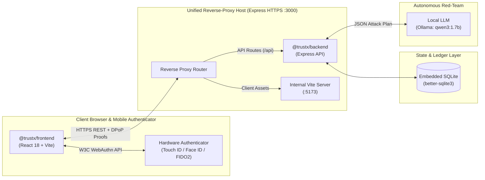

# Monorepo Packages (`packages/`)

This directory contains the workspace packages that comprise the **TrustX SovereignPass** monorepo, managed via npm workspaces (`packages/*`).

---

## Workspace Architecture

```text
packages/
├── backend/                  # Express HTTPS API, WebAuthn RP, SQLite store & AI harnesses
│   ├── src/                  # TypeScript source files (routes, middleware, services, db)
│   ├── test/                 # Integration test suites (IntentLock, Kiosk, Persistence, DPoP)
│   ├── package.json          # Package manifest (@trustx/backend)
│   └── README.md             # Backend architecture, API endpoints, and database schema
├── frontend/                 # React 18 client application (Vite, Tailwind, WebAuthn browser)
│   ├── src/                  # Client source files (pages, components, services, styles)
│   ├── package.json          # Package manifest (@trustx/frontend)
│   └── README.md             # Frontend application structure, routes, and design system
└── README.md                 # This monorepo packages overview
```

---

## Workspace Interoperability



---

## Workspace Package Manifest

| Package Name | Workspace Directory | Role & Responsibilities | Key Technologies |
| :--- | :--- | :--- | :--- |
| **`@trustx/backend`** | `packages/backend` | WebAuthn Relying Party engine, session state, two-phase recovery, kiosk engine, IntentLock gateway, and PersistenceGuard firewall. | Node.js, Express, TypeScript, `@simplewebauthn/server`, `better-sqlite3`, Argon2id. |
| **`@trustx/frontend`** | `packages/frontend` | Accessible citizen banking portal, Admin SOC dashboard, multi-window Demo Arena, Kiosk QR client, and visual security labs. | React 18, Vite, TypeScript, Tailwind CSS, `@simplewebauthn/browser`, Lucide Icons, Framer Motion. |

---

## Common Workspace Commands

From the monorepo root:

```bash
# Build both packages
npm run build

# Run unit and integration tests across workspaces
npm test

# Run backend only in watch mode
npm run dev:backend

# Run frontend only
npm run dev:frontend

# Run frontend in standalone tab-local mock mode
npm run dev:frontend:mock
```

---

## Primary Contributors

* **Sanchit Mishra** ([@san-10-max](https://github.com/san-10-max)) — Backend core services, WebAuthn RP, database schema, recovery & kiosk endpoints.
* **Ananya Robinson** ([@ananya411-robinson](https://github.com/ananya411-robinson)) — Frontend React application, Admin SOC, component system, accessible views, and Demo Arena.
* **Swayam Kohli** ([@SwayamKohli](https://github.com/SwayamKohli)) — Monorepo tooling, reverse proxy, DPoP session binding, IntentLock gateway, and persona integration.
* **Syed Adnan Ahmed Hanfi** ([@Theshyguy01](https://github.com/Theshyguy01)) — Attack probe integration and adversary origin simulation.
